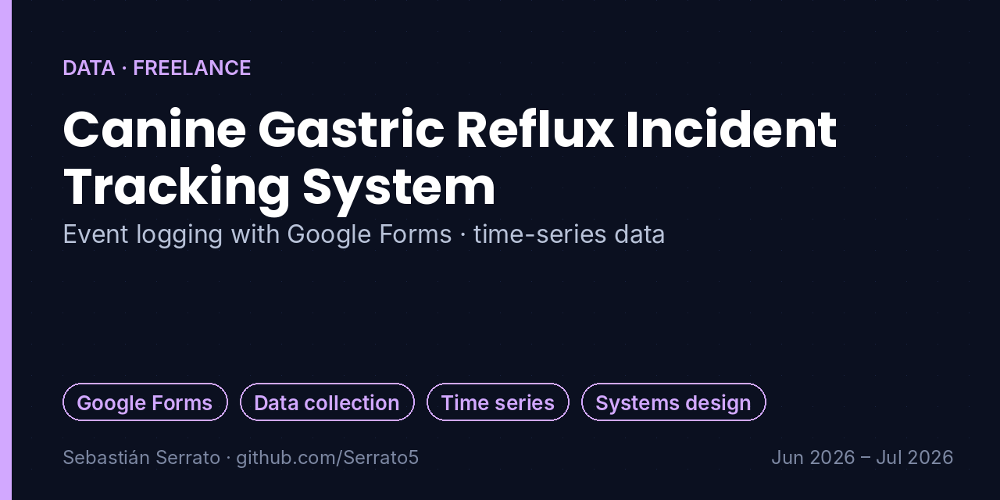
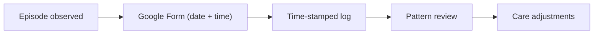

# Canine Gastric Reflux Incident Tracking System

**Event logging with Google Forms · time-series data**

`Google Forms` `Data collection` `Time series` `Systems design`

## Overview

A targeted event-logging system to record the frequency and timing of gastric reflux episodes in a dog with chronic inflammatory bowel disease (IBD), built as part of my freelance pet-care work.

> **Privacy:** this project was built for a private client. No personal data, health records or photos of the client or the animal are included here; only the design of the system is described.

## Key features

- **Real-time incident logging:** Streamlined digital log in Google Forms that records the exact date and time of each episode.
- **Time-series collection:** Sequential, time-stamped entries that build an objective record of when flare-ups happen.
- **Correlation support:** A base log that allows cross-referencing symptoms with feeding schedules, medication windows and environmental triggers.
- **Proactive care:** A clear history of discomfort patterns to support timely, data-backed adjustments to the daily routine.

## How it works

## What I learned

- A well-designed form beats memory: objective, time-stamped data.
- Designing for the person who records the data (fast, few fields).
- Data only helps if it can be cross-referenced with other events.

## Project context

| | |
|---|---|
| Context | Private client (freelance care services) |
| Dates | Jun 2026 – Jul 2026 |
| Area | Data · Freelance |

## Resumen en español

Sistema de registro de eventos en Google Forms para anotar la fecha y hora de cada episodio de reflujo de un perro con enfermedad inflamatoria intestinal, como apoyo a su cuidado diario dentro de mi trabajo como cuidador.

---

**About this repository:** the original source code and design files of this project were not preserved. This repository documents what was built, how it works and what I learned, based on my project records. It does not contain reconstructed code.

**Sobre este repositorio:** el código y los archivos originales de este proyecto no se conservaron. Aquí se documenta qué se construyó, cómo funciona y qué aprendí, sin código reconstruido.

**Author:** Sebastián Serrato Ramírez · Electronic Engineering student, Universidad Surcolombiana (Neiva, Colombia) · [LinkedIn](https://www.linkedin.com/in/sebaserrato) · [More projects](https://github.com/Serrato5)
